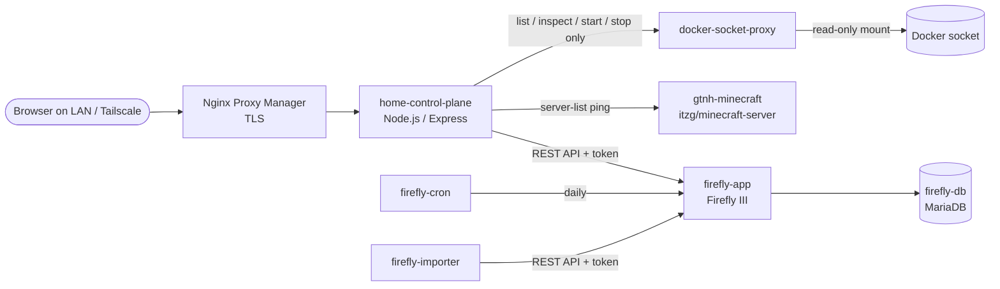

# Home Control Plane

A self-hosted dashboard for a home server. It shows host health at a glance,
starts and stops a containerized Minecraft server safely, and pulls a
personal-finance summary from a self-hosted Firefly III instance. One page
replaces a dozen browser tabs and SSH sessions.

The goal is a control plane, not a bookmarks page. Every feature should let
you *act* on a service or read live data from it, rather than just link to
it. The dashboard is reachable only over the LAN or Tailscale, behind a
reverse proxy with authentication.

## What it does

The overview page shows a short card for each area and fits a 1920x1080 browser tab without scrolling. A sidebar (a top bar on phones) opens a full page for each one.

| Area | What you get |
|------|--------------|
| **System vitals** | Live CPU load (click for a per-core breakdown) and RAM usage (click for memory per Docker container, largest first). Refreshes every 5 seconds. |
| **Minecraft control** | A hosting-panel style page for the GTNH and family servers. One-button start/stop; the status pill tells apart *stopped*, *starting* (container up, world still loading) and *online*, with player count, version and MOTD. Shutdown goes through RCON, so the world saves cleanly. Tabs for a live **console** (log plus commands over RCON), **players** (online, ops, bans, whitelist), a **file manager** (browse, edit, upload, rename, delete) and **backups** (download, one-click restore of the world). Files and restores only change while the server is stopped. |
| **Finances** | Net worth and the ten most recent transactions from Firefly III, read through its API. Hidden until an API token is configured. Statements are imported manually through Firefly's Data Importer, so no bank credentials ever reach a third-party aggregator. |
| **Pi-hole** | The last 24 hours: queries over time (allowed vs blocked), activity per client, query types, upstream servers, and top permitted domains, blocked domains and clients. Refreshes every 30 seconds. Hidden until the API password is set. |
| **Jellyfin** | Library counts, what's playing now with progress, recently added titles with posters, and users by last activity. Posters are fetched through the dashboard, so the API key never reaches the browser. Hidden until the API key is set. |
| **Quest board** | A game-style tracker at `/quests.html`: habits, dailies with step-by-step checklists (stretch and workout routines included), quest lines for homelab projects, and a reward shop. Completing things earns XP, gold, levels, streaks with freezes, about 90 achievements meant to take years, and collectible item drops. Missed dailies cost health. |
| **Service tiles** | Links to every other service in the homelab, driven by a JSON file, so adding a tile needs no code change. Each tile also has a direct `IP:port` link for when the reverse proxy or Pi-hole is down. |

## Architecture



All services run as Docker containers on a single Linux host, managed with
Docker Compose / Portainer. Pi-hole provides local DNS, and Nginx Proxy
Manager terminates TLS for each subdomain.

### Security choices

- **No raw Docker socket in the app.** The dashboard talks to
  [docker-socket-proxy](https://github.com/Tecnativa/docker-socket-proxy),
  which exposes only list, inspect, start and stop. It can't create, exec
  into or delete anything. Inspect still shows every container's
  environment (so every stack's passwords), so the proxy sits on a private
  `docker-api` network that only the dashboard joins, never on the shared
  `proxy-network`.
- **No login, but no cross-site writes.** The dashboard has no login (NPM's
  basic auth was removed so the phone app works), so anyone on the LAN or
  Tailscale can use it, and it's never port-forwarded to the internet. Writes
  that another website tries to make through your browser are refused
  (`server/same-site.js`).
- **Other containers can't use it.** The Minecraft servers face the
  internet and share a Docker network with the dashboard, so a hijacked
  server could otherwise call the console or file manager. Only Nginx Proxy
  Manager may reach the dashboard from inside Docker
  (`server/docker-guard.js`).
- **Minecraft is the one exception.** The family server is port-forwarded so
  family can join from home. Only whitelisted, signed-in accounts get in,
  and pings from IPs that no whitelisted player has joined from get no
  server info. See [Family server](docs/engineering-notes.md#who-can-get-in).
- **Secrets stay out of git.** Every password and token comes from a
  stack's Portainer environment variables (templates: `stacks/*/.env.example`).
  Compose refuses to start if a required value is missing.
- **One token per integration.** The dashboard and the Data Importer use
  separate Firefly tokens, so either can be revoked without breaking the
  other.
- **Internal-only ports.** RCON and the database are never published to
  the host, so only containers on the same Compose network can reach them.

## Tech stack

- **Backend:** Node.js 20, Express, [dockerode](https://github.com/apocas/dockerode),
  [systeminformation](https://systeminformation.io/), minecraft-server-util
- **Frontend:** plain HTML, CSS and JavaScript. No framework or build step.
- **Infrastructure:** Docker Compose, Portainer, Nginx Proxy Manager,
  Pi-hole, Tailscale
- **Services:** Firefly III + MariaDB, itzg/minecraft-server

## Repository layout

```
server/
  index.js               Express app + static file serving
  docker.js              Shared Docker client (talks to docker-socket-proxy)
  same-site.js           Refuses changes requested by other websites
  docker-guard.js        Refuses requests from other containers (only NPM gets in)
  routes/system.js       GET /api/system/cpu, /api/system/ram
  routes/minecraft.js    /api/minecraft/:server: status, start, stop, console, command, players, backups, restore
  routes/minecraft-files.js  /api/minecraft/:server/files: the file manager
  routes/firefly.js      GET /api/firefly/summary
  routes/services.js     GET /api/services
  routes/pihole.js       GET /api/pihole/summary (Pi-hole v6 API, one reused session)
  routes/jellyfin.js     GET /api/jellyfin/summary
  routes/quests.js       /api/quests: quest board API and input validation
  quests/engine.js       Game rules: XP, gold, HP, streaks, drops, day rollover
  quests/content.js      Achievements, collectibles, and the starter board
  config/services.json   Service tile list
public/                  The dashboard (index.html, styles.css, app.js, nav.js for the sidebar, charts.js for the SVG charts, icons.js for the line icons)
stacks/<name>/compose.yml    One per Portainer stack; see DEPLOY.md
stacks/<name>/.env.example   That stack's secrets, blank
docs/engineering-notes.md    Design decisions and incident write-ups
DEPLOY.md                Getting it onto a server via GitHub + Portainer
```

## Running it

**Locally** (vitals and tiles work; Docker and Minecraft features degrade
gracefully when there's no Docker daemon):

```bash
npm install
npm start          # http://localhost:3000
```

**On a server:**

Add each folder in `stacks/` as a Portainer git stack (see
[DEPLOY.md](DEPLOY.md)), point a
reverse-proxy host at `home-control-plane:3000` (the container, not the
host's port 3001, which refuses requests from other containers), and edit
`server/config/services.json` to match your own hostnames. The full
walkthrough, including Firefly's two-stage token setup, is in
[DEPLOY.md](DEPLOY.md) and [docs/engineering-notes.md](docs/engineering-notes.md).

### Configuration

| Variable | Used by | Purpose |
|----------|---------|---------|
| `RCON_PASSWORD` | Minecraft | Graceful shutdown over RCON (must match `server.properties`) |
| `FIREFLY_DB_PASSWORD` | Firefly + MariaDB | Database password, shared by both containers |
| `FIREFLY_APP_KEY` | Firefly | 32-character encryption key |
| `FIREFLY_STATIC_CRON_TOKEN` | Firefly + cron | Authenticates the daily cron job |
| `FIREFLY_API_TOKEN` | Dashboard | Read access to Firefly (optional; hides Finances if blank) |
| `PIHOLE_API_PASSWORD` | Dashboard | Pi-hole *app password* for the stats card (optional; hides it if blank) |
| `JELLYFIN_API_KEY` | Dashboard | Jellyfin API key for the library card (optional; hides it if blank) |
| `FIREFLY_IMPORTER_TOKEN` | Data Importer | Separate Firefly token for statement imports |

Non-secret settings (`MINECRAFT_HOST`, `MINECRAFT_PORT`, `FIREFLY_URL`,
`DOCKER_HOST`, …) are set directly in the compose file.

## Roadmap

Development is phased. Each phase ships, gets confirmed working on the real
server, and is closed out before the next one starts.

- [x] **Phase 1: Foundation.** Express skeleton, service tiles, live CPU/RAM vitals with per-core and per-container breakdowns.
- [x] **Phase 2: Minecraft control.** Moved the server from systemd + `screen` into Docker, added start/stop through a scoped socket proxy, and RCON-based graceful shutdown.
- [x] **Phase 3: Finances.** Firefly III with its own MariaDB, a daily cron companion, a manual statement importer, and a dashboard summary.
- [x] **Phase 4: Quest board.** A self-hosted, game-style task tracker with habits, dailies, quest lines, rewards, achievements and collectibles. The roadmap below lives there now.
- [x] **Phase 5: Pi-hole and Jellyfin pages.** A sidebar with an overview page and a detail page per service, including Pi-hole charts and Jellyfin posters.
- [x] **Phase 6: Calisthenics tracker.** Routines on dailies, a workout logger with a rest timer and per-exercise history, and a feedback engine that suggests moving up, dropping back, pushing or resting. Logging a workout completes its daily, so it earns quest board XP.

**Operational follow-ups**

- [ ] Find out why the GTNH world's automated backups stopped, and add a backup job outside the mod that's monitored.
- [x] Family server backups: they stopped because the server ran as vanilla, so DriveBackupV2 never loaded. It runs on Paper now, with an [mc-backup](https://github.com/itzg/docker-mc-backup) sidecar as a plugin-independent local copy.
- [x] Upgrade the Minecraft server to GTNH 2.9.0.
- [ ] Add RAM to the host. The 6 GB Minecraft JVM leaves little headroom on 11 GB.
- [ ] After the RAM upgrade, remove the check that stops `gtnh-minecraft` and `family-minecraft` running together (see the [engineering notes](docs/engineering-notes.md#family-server)).

## Lessons learned

Some of the more useful debugging from this project, written up in
[docs/engineering-notes.md](docs/engineering-notes.md):

- A Minecraft world that had been **silently hung for a month** behind an
  interactive Forge prompt no headless process could answer.
- **docker-socket-proxy's rule ordering** made `ALLOW_START`/`ALLOW_STOP`
  dead config until `POST=1`, found by reading the proxy's HAProxy rules.
- **Shutdowns being force-killed** because RCON was quietly disabled by
  `OVERRIDE_SERVER_PROPERTIES=false`, plus a `$` in a password that Compose
  interpolation silently truncated.
- A **stale MariaDB named volume** that kept resurrecting a mismatched
  password across container rebuilds.
