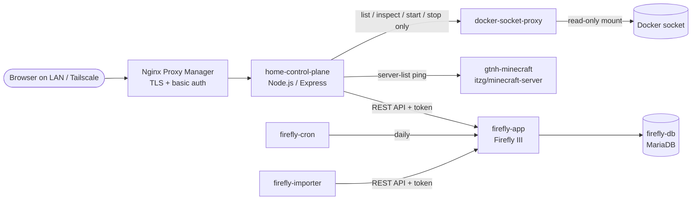

# Home Control Plane

A self-hosted dashboard for a home server. It shows host health at a glance,
starts and stops a containerized Minecraft server safely, and pulls a
personal-finance summary from a self-hosted Firefly III instance. One page
replaces a dozen browser tabs and SSH sessions.

The goal is a control plane, not a bookmarks page. Every feature should let
you *act* on a service or read live data from it, rather than just link to
it. The dashboard is reachable only over the LAN or Tailscale, behind a
reverse proxy with authentication.

## What it does

| Area | What you get |
|------|--------------|
| **System vitals** | Live CPU load (click for a per-core breakdown) and RAM usage (click for memory per Docker container, largest first). Refreshes every 5 seconds. |
| **Minecraft control** | One-button start/stop for a modded (GT: New Horizons) Minecraft server running in Docker. The status pill tells apart *stopped*, *starting* (container up, world still loading) and *online*, with player count, version and MOTD. Shutdown goes through RCON, so the world saves cleanly. |
| **Finances** | Net worth and the five most recent transactions from Firefly III, read through its API. Hidden until an API token is configured. Statements are imported manually through Firefly's Data Importer, so no bank credentials ever reach a third-party aggregator. |
| **Service tiles** | Links to the rest of the homelab (Portainer, Nginx Proxy Manager, Pi-hole, Jellyfin, Tandoor), driven by a JSON file, so adding a tile needs no code change. |

## Architecture



All services run as Docker containers on a single Linux host, managed with
Docker Compose / Portainer. Pi-hole provides local DNS, and Nginx Proxy
Manager terminates TLS for each subdomain.

### Security choices

- **No raw Docker socket in the app.** The dashboard talks to
  [docker-socket-proxy](https://github.com/Tecnativa/docker-socket-proxy),
  which exposes only list, inspect, start and stop. A bug in the dashboard
  can at worst start or stop a container. It can't create, exec into or
  delete anything.
- **Auth lives at the edge.** The app has no login code. Nginx Proxy
  Manager enforces basic auth, and nothing is port-forwarded to the
  internet.
- **Secrets stay out of git.** Every password and token comes from a
  gitignored `.env` file (template: [`.env.example`](.env.example)).
  Compose refuses to start if a required value is missing.
- **One token per integration.** The dashboard and the Data Importer use
  separate Firefly tokens, so either can be revoked without breaking the
  other.
- **Internal-only ports.** RCON and the database are never published to
  the host, so only containers on the same Compose network can reach them.

## Tech stack

- **Backend:** Node.js 20, Express, [dockerode](https://github.com/apocas/dockerode),
  [systeminformation](https://systeminformation.io/), minecraft-server-util
- **Frontend:** plain HTML, CSS and JavaScript. No framework or build step.
- **Infrastructure:** Docker Compose, Portainer, Nginx Proxy Manager,
  Pi-hole, Tailscale
- **Services:** Firefly III + MariaDB, itzg/minecraft-server

## Repository layout

```
server/
  index.js               Express app + static file serving
  docker.js              Shared Docker client (talks to docker-socket-proxy)
  routes/system.js       GET /api/system/cpu, /api/system/ram
  routes/minecraft.js    GET /api/minecraft/:server/status, POST /start, /stop
  routes/firefly.js      GET /api/firefly/summary
  routes/services.js     GET /api/services
  config/services.json   Service tile list
public/                  The dashboard (index.html, styles.css, app.js)
docker-compose.snippet.yml   Every container in the stack
.env.example             Every secret the stack needs, blank
docs/engineering-notes.md    Design decisions and incident write-ups
DEPLOY.md                Getting it onto a server via GitHub + Portainer
```

## Running it

**Locally** (vitals and tiles work; Docker and Minecraft features degrade
gracefully when there's no Docker daemon):

```bash
npm install
npm start          # http://localhost:3000
```

**On a server:**

```bash
cp .env.example .env      # fill in values; see comments in the file
docker compose -f docker-compose.snippet.yml up -d --build
```

Then point a reverse-proxy host with authentication at port `3001`, and
edit `server/config/services.json` to match your own hostnames. The full
walkthrough, including Firefly's two-stage token setup, is in
[DEPLOY.md](DEPLOY.md) and [docs/engineering-notes.md](docs/engineering-notes.md).

### Configuration

| Variable | Used by | Purpose |
|----------|---------|---------|
| `RCON_PASSWORD` | Minecraft | Graceful shutdown over RCON (must match `server.properties`) |
| `FILEBROWSER_ADMIN_PASSWORD` | FileBrowser Quantum | Admin login for the server file manager |
| `FIREFLY_DB_PASSWORD` | Firefly + MariaDB | Database password, shared by both containers |
| `FIREFLY_APP_KEY` | Firefly | 32-character encryption key |
| `FIREFLY_STATIC_CRON_TOKEN` | Firefly + cron | Authenticates the daily cron job |
| `FIREFLY_API_TOKEN` | Dashboard | Read access to Firefly (optional; hides Finances if blank) |
| `FIREFLY_IMPORTER_TOKEN` | Data Importer | Separate Firefly token for statement imports |

Non-secret settings (`MINECRAFT_HOST`, `MINECRAFT_PORT`, `FIREFLY_URL`,
`DOCKER_HOST`, …) are set directly in the compose file.

## Roadmap

Development is phased. Each phase ships, gets confirmed working on the real
server, and is closed out before the next one starts.

- [x] **Phase 1: Foundation.** Express skeleton, service tiles, live CPU/RAM vitals with per-core and per-container breakdowns.
- [x] **Phase 2: Minecraft control.** Moved the server from systemd + `screen` into Docker, added start/stop through a scoped socket proxy, and RCON-based graceful shutdown.
- [x] **Phase 3: Finances.** Firefly III with its own MariaDB, a daily cron companion, a manual statement importer, and a dashboard summary.
- [ ] **Phase 4: Calisthenics tracker.** A routine builder, then session logging, then a feedback engine that adjusts routines based on logged sessions. Each step depends on the previous one.
- [ ] **Phase 5: Pi-hole stats.** Replace the Pi-hole link with a native tile showing queries, block rate and top blocked domains.

**Operational follow-ups**

- [ ] Find out why the Minecraft world's automated backups stopped, and add a backup job outside the mod that's monitored.
- [ ] Upgrade the Minecraft server to GTNH 2.9.0 (compose changes are prepped).
- [ ] Add RAM to the host. The 6 GB Minecraft JVM leaves little headroom on 11 GB.
- [ ] After the RAM upgrade, remove the check that stops `gtnh-minecraft` and `family-minecraft` running together (see the [engineering notes](docs/engineering-notes.md#family-server)).

## Lessons learned

Some of the more useful debugging from this project, written up in
[docs/engineering-notes.md](docs/engineering-notes.md):

- A Minecraft world that had been **silently hung for a month** behind an
  interactive Forge prompt no headless process could answer.
- **docker-socket-proxy's rule ordering** made `ALLOW_START`/`ALLOW_STOP`
  dead config until `POST=1`, found by reading the proxy's HAProxy rules.
- **Shutdowns being force-killed** because RCON was quietly disabled by
  `OVERRIDE_SERVER_PROPERTIES=false`, plus a `$` in a password that Compose
  interpolation silently truncated.
- A **stale MariaDB named volume** that kept resurrecting a mismatched
  password across container rebuilds.
